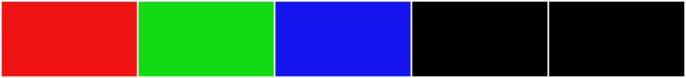

# When the last frame is accurate but unusable

A frame extractor can save exactly the right final frame and still give you the wrong reference for your editing task. A fade, cut to black or motion blur can make the end unsuitable. Unequal spacing between video frames adds another trap: a frame number is not a timestamp.

This extension to the frame-timing lab separates three questions:

1. Which decoded frame is last?
2. When does a chosen frame appear?
3. Is that picture useful for the next edit?

## A small fixture you can inspect



The [original synthetic clip](fixtures/vfr-endings/vfr-black-ending.mp4) contains five 320×180 frames. It is intentionally simple: the colours make a wrong selection easy to spot. It is not customer footage or an AI-generated video.

| Zero-based frame index | Picture | Observed presentation time | Gap until next frame |
|---|---|---|---|
| 0 | Red | 0.00 s | 0.08 s |
| 1 | Green | 0.08 s | 0.40 s |
| 2 | Blue | 0.48 s | 0.12 s |
| 3 | Black | 0.60 s | 0.20 s |
| 4 | Black | 0.80 s | No next frame |

These timestamps were read from the encoded clip, not inferred from the file's duration or an average frame rate. A formula such as `index / average_fps` cannot reconstruct this sequence of unequal gaps.

The full decode produces [a black last-frame PNG](fixtures/vfr-endings/last.png). Selecting index 2 produces [the blue PNG](fixtures/vfr-endings/selected.png). Both are correct results for different requests. In a real clip, choosing the earlier frame also requires checking faces, hands, labels and motion; this colour fixture cannot make that judgement.

## Reproduce the observation

Requirements: Python 3.10+ and an FFmpeg build with the concat demuxer, PPM decoding, H.264 encoding through `libx264`, PNG encoding, and the `select`, `showinfo` and `tile` filters. No Python packages are required, no executable is bundled, and no network request is made by the script.

```text
python vfr_endings_lab.py --out my-vfr-run
```

If FFmpeg is not on your command path:

```text
python vfr_endings_lab.py --ffmpeg "/path/to/ffmpeg" --out my-vfr-run
```

Use a new output directory. The script refuses an existing directory, generates its own source images, encodes the clip, exports the two PNGs, decodes their pixels, reads their dimensions and checks the timestamps. Its [recorded result](fixtures/vfr-endings/result.json) contains six checks from an actual FFmpeg 7.1 run on 1 November 2026.

For your own media, first inspect the video streams and keep an unchanged source copy. These examples select only the first video stream. Use a new destination filename to preserve an earlier export.

```text
ffmpeg -n -i "input.mp4" -map 0:v:0 -an -vf showinfo -f null -
ffmpeg -n -i "input.mp4" -map 0:v:0 -an -fps_mode passthrough -update 1 "last.png"
ffmpeg -n -i "input.mp4" -map 0:v:0 -an -vf "select=eq(n\,2)" -frames:v 1 -fps_mode passthrough -update 1 "selected.png"
```

The middle command repeatedly replaces its newly created output image while decoding, leaving the final frame. The last command saves zero-based frame 2; change that index deliberately. Neither command chooses the most useful picture. FFmpeg's [image2 options](https://ffmpeg.org/ffmpeg-formats.html#image2-2) describe `update`, and its [filter reference](https://ffmpeg.org/ffmpeg-filters.html) describes `select` and `showinfo`.

## Browser workflow and handoff

For a visual selection workflow, [ImgMov's last-frame utility](https://imgmov.com/extract-last-frame-from-video) lets you inspect ending frames and download a PNG. A fresh anonymous check on 1 November 2026 used its built-in sample and produced a decoded 704×704 PNG. That was a separate browser check; this VFR fixture has not been used to certify its frame-selection behaviour.

If a selected still needs a different shape, [ImgMov's image preparation utility](https://imgmov.com/resize-image-for-ai-video) offers cropping or padding. A separate synthetic-image check exported an exact 720×1280 JPEG. Padding is visible content, and cropping removes edges; neither guarantees acceptance or continuity in a downstream generator.

Record the chosen source timestamp in the handoff. If it is earlier than the original ending, align the cut in your editor with that chosen picture. Merely saving an earlier PNG does not remove the later black or blurred frames from the movie.

## Boundaries

This test covers one ordinary SDR H.264 fixture with unequal frame spacing and a deliberately black ending. It does not test arbitrary phone VFR recordings, HDR, rotation metadata, non-square pixels, damaged files, multiple video tracks, browser codecs, or audio/video synchronization. Do not interpret black pixels in this fixture as an automatic quality detector for real footage.

The guide and fixture were prepared with AI assistance by contributors working on ImgMov. The two browser-tool links are affiliated. The generation backend is outside this lab and is not claimed available. The existing repository MIT license covers this newly authored text, code and synthetic media; external projects retain their own licences.
